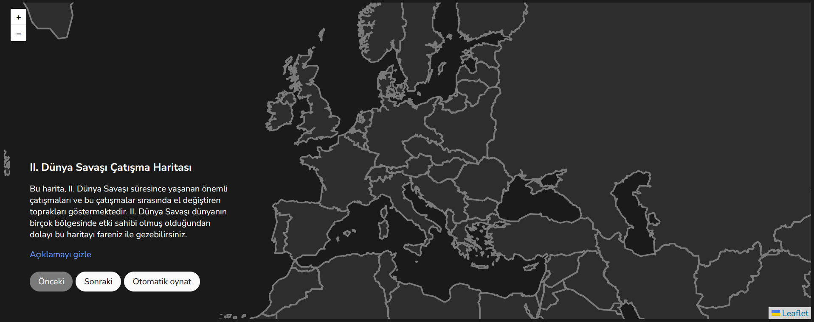

# II. Dünya Savaş Çatışma Haritası
**II. Dünya Savaşı Çatışma Haritası**, II. Dünya Savaşı sırasında yaşanan önemli olayları harita üzerinde interaktif bir biçimde gösterir.

Tamamen statik bir biçimde tasarlanan **II. Dünya Savaşı Çatışma Haritası**, [Leaflet](https://leafletjs.com) kullanılarak hazırlanmıştır.

Bu siteyi [ww2.alprys.com](https://ww2.alprys.com) adresinde görüntüleyebilirsiniz.

## İçerik
- [Özellikler](#özellikler)
- [Önemli Olaylar](#önemli-olaylar)
- [Kurulum ve Çalıştırma](#kurulum-ve-çalıştırma)

## Özellikler
**II. Dünya Savaşı Çatışma Haritası**nda kullanıcılar II. Dünya Savaşı sırasında yaşanan olaylar hakkında genel bilgi sahibi olmak için açıklamaların yer aldığı menüyü kullanabilirler. Dünya haritasındaki ülkelerde de ülkelerin savaş sırasındaki durumları hakkında genel bilgiler yer almaktadır, kullanıcılar ülkelere tıklayarak bu açıklamaları görüntüleyebilirler.

Kullanıcılar olaylar arasında kendileri ilerleyebileceği gibi otomatik oynatma özelliğini kullanarak **her 10 saniyede bir** yeni bir olay görüntüleyebilirler.

**II. Dünya Savaşı Çatışma Haritası** tamamen statik bir proje olup site tasarımı yalnızca `HTML`, `JavaScript` ve `CSS` kullanılarak hazırlanmıştır. Haritalar ise `GeoJSON` uzantılı dosyalar kullanılarak oluşturulmuştur.

## Önemli Olaylar
**II. Dünya Savaşı Çatışma Haritası**, 20 farklı olay sayfasından oluşur.

Bu olaylar,
- II. Dünya Savaşı'na Giden Süreç
- Mançurya'nın İşgali
- Hitler'in Şansölye Olması ve Nazizm
- *Anchluss*
- Yatıştırma Politikası
- Molotov-Ribbentrop Paktı ve Polonya'nın İşgali
- Norveç ve Danimarka'nın İşgali
- *Blitzkrieg* ve Fransa'nın İşgali
- İngiltere'ye Saldırı
- Yunanistan'ın İşgali
- Barbarossa Harekatı
- Pearl Harbor
- Stalingrad Muharebesi
- Husky Harekatı
- Normandiya Çıkarması (D-Day)
- Almanya'nın Teslim Olması
- Pasifik Cephesi
- Atom Bombası
- Japonya'nın Teslim Olması
- Soğuk Savaş
şeklindedir.

## Kurulum ve Çalıştırma
Bu site tamamen statik olduğu için [GitHub Pages](https://pages.github.com) üzerinden çalıştırılabilmektedir.

Bu siteyi yerel bilgisayarınızda çalıştırmak için [Visual Studio Code](https://code.visualstudio.com/) uygulamasındaki önizleme özelliğini kullanabilirsiniz. Buradaki kodu indirip doğrudan dosyalar üzerinden açmak (`file:///` uzantısı ile başlayacak biçimde), interaktif haritayı çalıştırmak için **yeterli değildir** (Leaflet bu şekilde çalıştırılamaz)! Bu sitenin yerel bir sunucu ile çalıştırılması gerekmektedir.